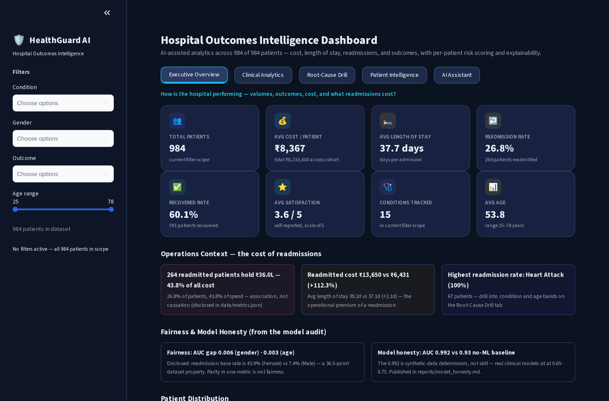
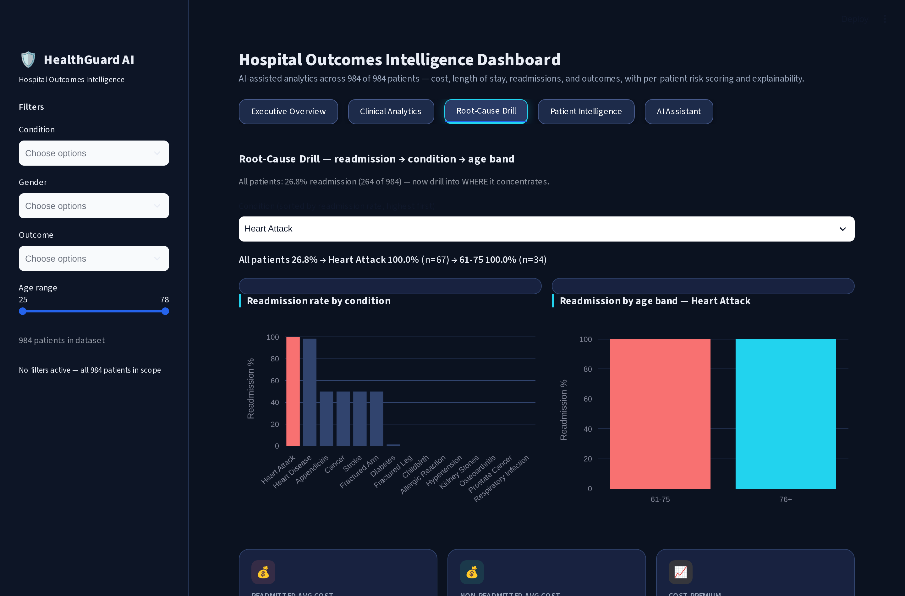
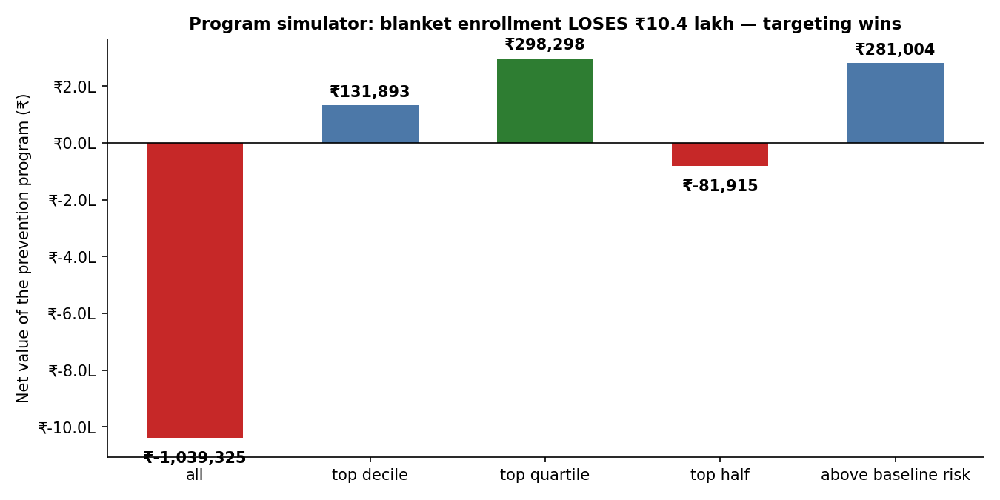
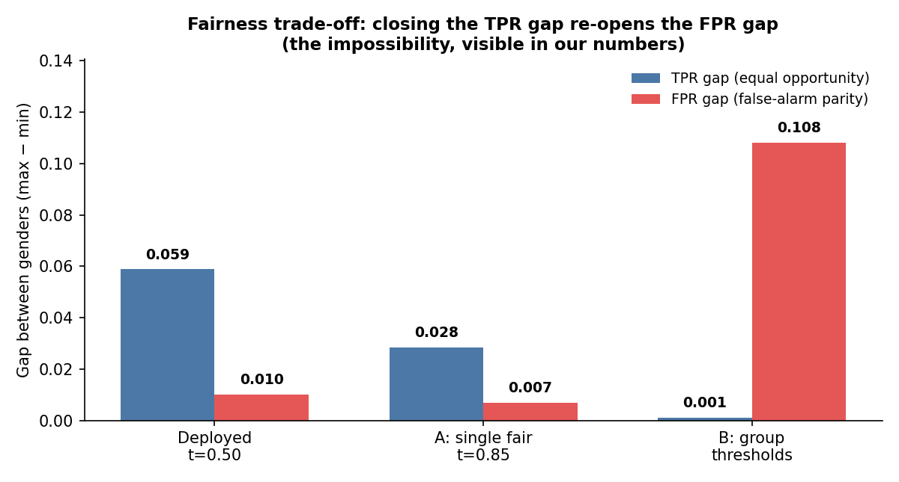

# HealthGuard AI — Hospital Operations Analytics & Model Evaluation

**An analytics-first healthcare portfolio prototype** for exploring synthetic outcomes, costs, length of stay, and subgroup patterns in a filterable dashboard—with a separately evaluated readmission model and explicit model-honesty checks.

[Live demo (Streamlit sign-in may be required)](https://healthguard-ai-cyl2viwrsdrrff7pig7u6c.streamlit.app/) · [Executive summary](reports/executive_summary.md) · [Data dictionary](data/DATA_DICTIONARY.md) · [Model honesty audit](reports/model_honesty.md) · [Calibration and decision curves](reports/calibration_and_decision_curve.md) · [Temporal validation](reports/temporal_validation.md) · [Model card](models/readmission/MODEL_CARD.md) · [Intervention economics](reports/program_simulator.md) · [Fairness trade-off](reports/fairness_tradeoff.md) · [Tests](tests/) · [Release gates](docs/RELEASE_GATES.md)

[](https://github.com/rishi-1603/HealthGuard-AI/actions/workflows/ci.yml) 

> ### 🧭 Recruiter & Interview Verification Hub (October 2026 Comprehensive Upgrade)
> - **Direct Resume Evidence Index:** [RESUME_EVIDENCE.md](RESUME_EVIDENCE.md) *(Claims, definitions, reproduction commands, & test files)*
> - **Executive Clinical Brief:** [docs/EXECUTIVE_FINDINGS_REPORT.md](docs/EXECUTIVE_FINDINGS_REPORT.md) *(Cost concentration, clinical baseline power, & intervention economics)*
> - **Prediction Point Methodology:** [docs/PREDICTION_POINT_METHODOLOGY.md](docs/PREDICTION_POINT_METHODOLOGY.md) *(Prediction at discharge & feature leakage boundaries)*
> - **Methodology & Synthetic Limitations:** [docs/SYNTHETIC_DATA_LIMITATIONS.md](docs/SYNTHETIC_DATA_LIMITATIONS.md) *(Why 0.99 AUC is synthetic structure vs real-world EHR)*
> - **Consolidated Baseline Matrix:** [docs/MODEL_EVALUATION_CONSOLIDATION.md](docs/MODEL_EVALUATION_CONSOLIDATION.md) *(No-ML 0.929 baseline vs Logistic Regression vs RF)*
> - **Hospital Operations Analytics:** [docs/HOSPITAL_OPERATIONS_ANALYTICS.md](docs/HOSPITAL_OPERATIONS_ANALYTICS.md) *(Length of stay, cost asymmetry, & Rs. 2.98L net benefit)*
> - **Fairness & Subgroup Audit:** [docs/FAIRNESS_AND_SUBGROUP_AUDIT.md](docs/FAIRNESS_AND_SUBGROUP_AUDIT.md) *(Gender and age band performance parity breakdown)*
> - **Offline Demo Fallback Guide:** [docs/DEMO_FALLBACK_GUIDE.md](docs/DEMO_FALLBACK_GUIDE.md) *(Local instant execution & smoke-test instructions)*

---


> **Safety and data notice:** This project uses **984 synthetic patient records**. The primary dashboard uses only those synthetic records; a separate external-validation track includes a public UCI clinical reference dataset. It is not intended for diagnosis, treatment, care prioritization, or clinical decision-making. All outcome, cost, subgroup, and model metrics are illustrative properties of the generated dataset—not evidence of patient benefit or clinical validity.

## Executive summary

The primary deliverable is an operations-style analytics dashboard: a reviewer can filter outcomes, compare cost and length of stay, inspect condition and demographic breakdowns, and trace displayed figures to a shared metric registry. A model and SHAP explanations are included as a supporting Data Science layer, joined by intervention economics, a priced fairness trade-off curve, and a grounded-Q&A benchmark; the project’s main evaluation finding is that the unusually high AUC is explained by the synthetic label-generation process.

**Role emphasis:** Data Analyst first (metric definitions, data-quality checks, outcome and cost analysis, subgroup comparisons, dashboard communication); applied Data Science second (model validation, calibration, decision-curve analysis, explainability, temporal protocol, error analysis, intervention economics, and fairness trade-off analysis).

## At a glance

| Area | Dataset result | Correct interpretation |
|---|---:|---|
| Readmission records | **264 / 984 (26.8%)** | Synthetic outcome rate; not a hospital benchmark |
| Cost concentration | Readmitted records account for **₹36.0 lakh (43.8%)** of total recorded cost | Association in generated data—not evidence that readmission caused the cost |
| Average cost | **₹13,650** for readmitted vs. **₹6,431** for non-readmitted records | Descriptive comparison; not case-mix adjusted |
| Model honesty | Protocol-specific Random Forest AUCs are **0.992–0.994**; the condition-only lookup baseline is **0.929** | The label is nearly determined by the synthetic condition pathway; the AUC is not clinical predictive skill |
| Probability quality | Brier **0.0187 → 0.0102** after isotonic calibration on a separate evaluation protocol | Improvement on this synthetic split; not evidence of clinical utility |
| Temporal check | Time-split AUC **0.9963**, within the random-split sampling-noise band **[0.9934, 1.0000]** | Synthetic dates are independent of outcomes; no real temporal generalization is demonstrated |

Metric definitions and caveats are maintained in [`data/metrics.json`](data/metrics.json). The model, calibration, and temporal reports use distinct documented evaluation protocols; do not combine their metrics as though they came from one split.

## 1. Analytics workflow and dashboard

### Questions explored

| Operations / analyst question | Dashboard or report | What the analysis supports |
|---|---|---|
| What outcomes, costs, and utilization appear in the dataset? | KPI panel and descriptive summaries | A consistent view of volume, readmission, cost, length of stay, recovery, and satisfaction |
| How do outcomes vary across condition, age, and gender? | Filterable breakdowns and condition/age drill-down | Identify where the synthetic records concentrate; use as a prompt for further investigation, not a causal explanation |
| What cost burden is associated with readmission status? | Cost-burden view | Quantify group differences and state the association without claiming cause |
| Can a user ask a question and trace the answer? | Data-grounded Q&A panel | Supported answers are computed from the active data slice; ungroundable questions are refused or routed to a clearly labelled optional fallback |
| Are dashboard numbers and assumptions discoverable? | `data/metrics.json`, data dictionary, and data-quality report | Definitions, provenance, and known generator properties are visible rather than buried in code |

### Selected descriptive findings

- **Cost concentration:** 264 records marked readmitted represent 26.8% of the dataset and account for 43.8% of recorded cost. Their mean cost is ₹13,650 versus ₹6,431 for other records. The data is synthetic, and this comparison is neither causal nor adjusted for case mix.
- **Condition concentration:** the generated outcome is strongly associated with condition and its one-to-one procedure mapping. This is a property of the generator and is the reason the model audit is central to the project.
- **Subgroup caution:** synthetic gender base rates differ sharply (43.9% female vs. 7.4% male). Similar AUCs across groups do not establish fairness; the project reports the disparity and makes no fairness claim about real populations.

### Dashboard preview

[Open the live demo](https://healthguard-ai-cyl2viwrsdrrff7pig7u6c.streamlit.app/)





The Streamlit app includes outcome and cost summaries, patient-level views, SHAP explanations, cohort analysis, data-grounded questions, and operational context. Any patient-level risk view is a demonstration on synthetic records—not a clinical recommendation.

## 2. Data and measurement

| Item | Description |
|---|---|
| Source | Seeded synthetic generator; no hospital or patient source system |
| Population | 984 generated records, one row per synthetic patient |
| Shape | 10 columns; 15 conditions and 15 procedures with a 1:1 mapping |
| Limitations | No real admission history, comorbidities, medications, laboratory results, or post-discharge timeline |
| Data documentation | [`data/DATA_DICTIONARY.md`](data/DATA_DICTIONARY.md) |
| Quality checks | [`reports/data_quality_report.md`](reports/data_quality_report.md) |
| Metric registry | [`data/metrics.json`](data/metrics.json) |

The registry is the canonical location for user-facing metric definitions and caveats. Cost differences are descriptive; the dataset is not case-mix adjusted, and it cannot establish that a clinical pathway caused a cost or outcome.

## 3. Applied Data Science (supporting layer)

### Model and honesty audit

The shipped Random Forest uses six demographic, condition, procedure, cost, and length-of-stay features. The stand-alone model artifact and its same-split honesty audit report ROC-AUC **0.994** on a stratified 80/20 split (197 held-out records). The dashboard metric registry pins **0.992**, while the separate random split in temporal validation is **0.9923**; these protocol-specific values are kept distinct rather than averaged. The honesty audit obtains **0.929** from a per-condition lookup without ML and **0.985** from demographics/utilization features alone. Procedure is a one-to-one proxy for condition, and the generated outcome is nearly deterministic for many conditions.

**Interpretation:** this is a synthetic target-structure demonstration—not proof of real predictive skill. The audit distinguishes generator-driven target determinism from a claim of clinical accuracy. See [`reports/model_honesty.md`](reports/model_honesty.md) and [`models/readmission/MODEL_CARD.md`](models/readmission/MODEL_CARD.md).

### Calibration and decision-curve analysis

On a separate fit/calibration/test split (64/16/20; 197 test records), the raw model has Brier score **0.0187**, 10-bin ECE **0.0463**, and calibration slope **1.4341**. Isotonic calibration reduces Brier to **0.0102** and ECE to **0.0101** on that evaluation. Decision-curve analysis finds higher net benefit than treat-all at 7 tested thresholds from 0.10 to 0.50. These are method results on synthetic labels; they do not establish that acting on the scores would benefit patients.

### Subgroups, temporal validation, and errors

- **Subgroup uncertainty:** bootstrap confidence intervals are shown only when sample-size rules are met. Age bands with fewer than five positive cases are explicitly refused rather than assigned unstable metrics.
- **Fairness:** the reported AUC gaps are small (0.006 by gender; 0.003 by age), but the dataset has a 36.5 percentage-point gender base-rate difference. One parity metric is not a fairness conclusion. See [`reports/fairness_check.md`](reports/fairness_check.md).
- **Temporal protocol:** random-split AUC is 0.9923 and time-split AUC is 0.9963; the time-split result falls inside the random-split noise band. Dates were generated independently of outcomes, so the protocol—not a generalization claim—is the useful artifact. See [`reports/temporal_validation.md`](reports/temporal_validation.md).
- **Error analysis:** two held-out errors map to the synthetic generator’s stochastic cases. See [`reports/error_analysis.md`](reports/error_analysis.md).
- **Explainability:** SHAP describes how the fitted model uses its inputs; it does not identify real clinical causes or validate the model. See [`reports/cohort_shap.md`](reports/cohort_shap.md).

### Intervention economics: is prevention worth funding?



A program simulator ([`reports/program_simulator.md`](reports/program_simulator.md)) prices the targeting decision instead of stopping at a risk score. At ₹2,000 per enrolled patient, enrolling the **top-risk quartile nets +₹298,298** (ROI 0.61; break-even efficacy 15.6%), while enrolling everyone **loses ₹1,039,325** (break-even efficacy 53.0%). The targeting decision is worth more than the model. Values are dataset-specific; the method transfers.

### Fairness trade-off curve



A priced mitigation analysis ([`reports/fairness_tradeoff.md`](reports/fairness_tradeoff.md)) maps the equal-opportunity (TPR) gap against policy options: unconstrained, the gap is **0.059**; group-specific thresholds reduce it to **0.001** (recall 97.0%, precision 83.4%). In this threshold search, the lower TPR gap comes with a larger FPR gap. This is an observed policy trade-off, not a proof that unequal base rates alone make simultaneous TPR/FPR parity impossible; fairness impossibility results require additional conditions, such as calibration. The JSON reports both gaps, and the external-data track documents a different result.

### SQL analytics, grounded Q&A benchmark, and real-data validation

A real SQL analytics layer ([`reports/sql_analytics.md`](reports/sql_analytics.md)) answers the business questions directly in the database. The grounded Q&A is benchmarked ([`reports/qa_eval.md`](reports/qa_eval.md)): **8/8 answerable questions grounded in data, 3/3 out-of-scope refusals, 3/3 false-premise traps caught, 0 fabrications**. A real-data track ([`reports/realdata_validation.md`](reports/realdata_validation.md)) re-runs the fairness trade-off and intervention economics on the public UCI Cleveland Heart Disease dataset (303 patients, CC BY 4.0), so the two headline methods are tested outside the synthetic generator.

## 4. Reproduce locally

The CI workflow uses Python 3.11. From the repository root:

```bash
python -m venv .venv
source .venv/bin/activate          # Windows: .venv\Scripts\activate
python -m pip install -r requirements.txt

# Launch the dashboard
streamlit run app/dashboard/Home.py

# Regenerate evaluation reports
python scripts/model_honesty_audit.py
python scripts/calibration_decision_curve.py
python scripts/temporal_validation.py

# Run all automated checks
python -m pytest -q
```

An optional Gemini fallback can be configured through the platform’s secrets or an environment variable; the core descriptive dashboard and grounded Q&A are designed to run without an API key. Never commit credentials. The project also includes a Dockerfile and Compose configuration for local execution.

## Repository map

```text
├── app/dashboard/       # Streamlit application and analytics components
├── data/                # synthetic hospital records, dictionary, metric registry
├── models/readmission/  # model, encoders, metrics, and model card
├── scripts/             # training, calibration, fairness, temporal, honesty, simulation, and Q&A analyses
├── reports/             # executive, data-quality, model, fairness, and error reports
├── docs/                # architecture, evaluation, governance, and release checks
├── tests/               # 132 automated tests, including Q&A and evaluation-depth checks
└── Dockerfile           # containerized local run
```

## Limitations and safety boundary

- The primary dashboard and model metrics use synthetic records. The separately labelled UCI external-validation track uses a public clinical reference dataset and a different outcome (disease presence, not readmission).
- The outcome is strongly encoded by the generated condition/procedure pathway. High AUC is not evidence of clinical skill.
- Cost, age, and subgroup comparisons are descriptive and can reflect generator choices; they do not establish causality, fairness, or patient benefit.
- The one-row-per-patient table has no true longitudinal admissions timeline. The synthetic time split cannot establish temporal generalization.
- The Q&A layer supports a bounded set of data questions; the optional Gemini response is a labelled best-effort fallback, not a source of validated medical advice.
- This repository is for analytics and model-evaluation demonstration only. Do not use it to diagnose, treat, triage, or make decisions about real patients.

For full methodology and assumptions, see [`reports/assumptions_and_limitations.md`](reports/assumptions_and_limitations.md) and [`reports/methodology.md`](reports/methodology.md). The release checklist is [`docs/RELEASE_GATES.md`](docs/RELEASE_GATES.md); every bug found during development is recorded in [`docs/ascension/DECISIONS.md`](docs/ascension/DECISIONS.md). Latest audited suite: **132 tests passed** (2026-10-18).
