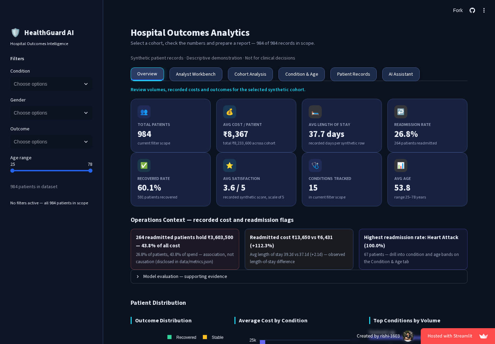
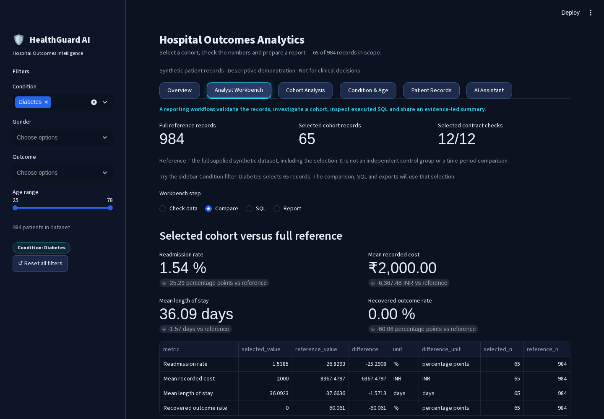
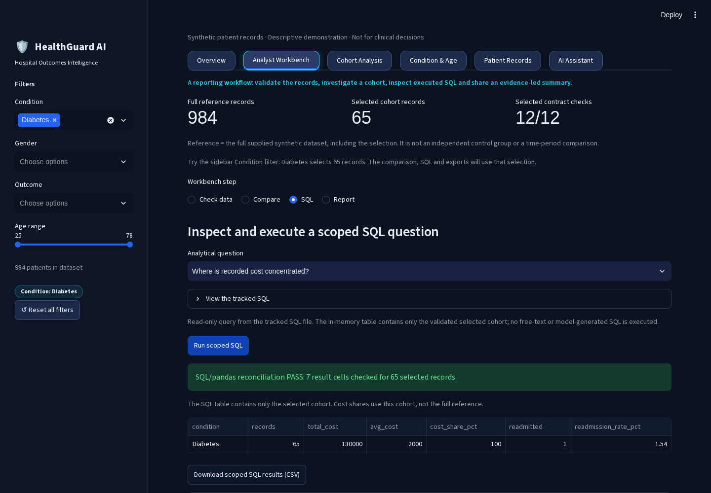
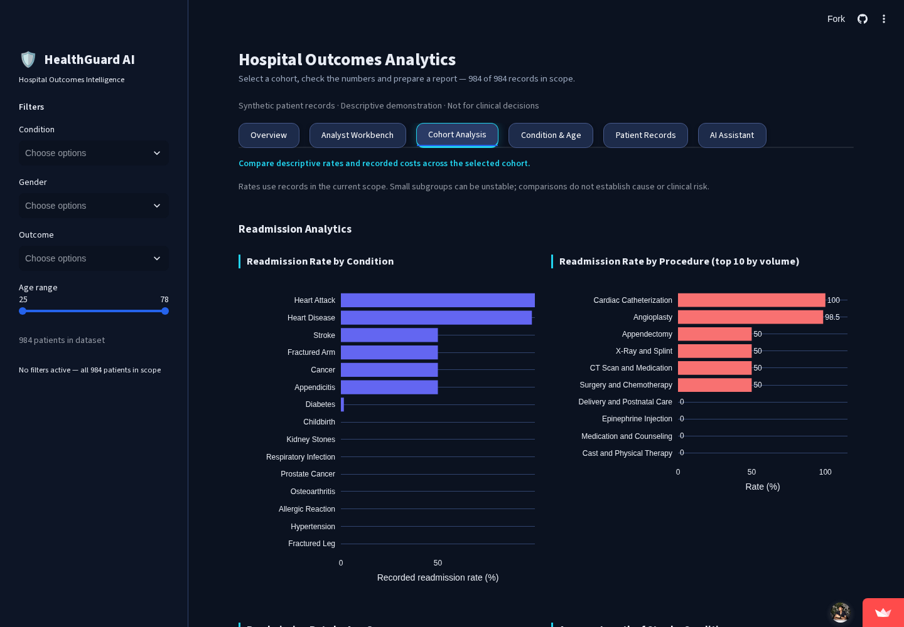
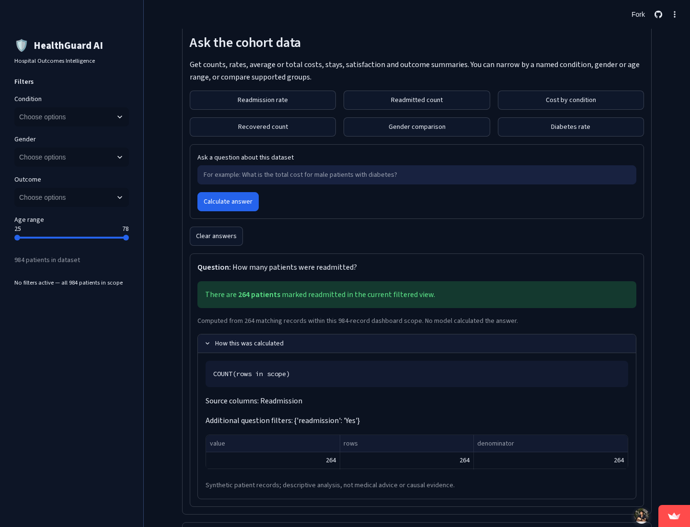
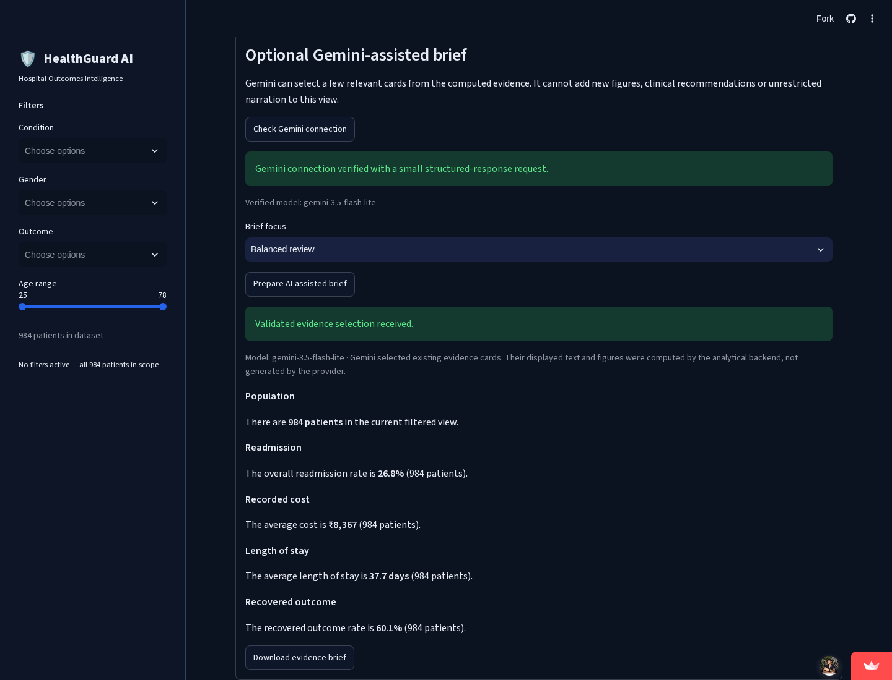

# HealthGuard AI — Hospital Outcomes Analytics

An exploratory dashboard for reviewing hospital outcomes, readmission flags and recorded costs. The main question is straightforward: **where are costs and outcomes concentrated, and which comparisons need more investigation?**

[Open the dashboard](https://healthguard-ai-cyl2viwrsdrrff7pig7u6c.streamlit.app/) · [Executive findings](docs/EXECUTIVE_FINDINGS_REPORT.md) · [SQL analysis](reports/sql_analytics.md) · [Data dictionary](data/DATA_DICTIONARY.md)

[](https://github.com/rishi-1603/HealthGuard-AI/actions/workflows/ci.yml)



> The primary dashboard uses 984 synthetic patient records. It is not for diagnosis, treatment, triage or clinical decisions. A separate external-validation track uses public UCI heart-disease data with a different outcome; it is not a validation of real-world readmission performance.

## Start with the records, not the model

Each row represents one synthetic patient record, not a longitudinal admission history. The data includes age, gender, condition, procedure, cost, length of stay, readmission flag, outcome and satisfaction.

An operations analyst can use the dashboard to compare condition groups, examine cost concentration and check whether a headline rate changes after filtering. The model and its explanations are supporting demonstrations. They do not turn these records into clinical evidence.

| Measure | Full dataset |
|---|---:|
| Patient records | 984 |
| Marked readmitted | 264 (26.83%) |
| Conditions | 15 |
| Mean recorded cost | ₹8,367 |
| Mean length of stay | 37.7 days |
| Recovered outcome | 60.1% |

Definitions and population boundaries are recorded in [the metric registry](data/metrics.json).

## What the analysis shows

### Readmitted records account for a disproportionate share of cost

Records marked readmitted make up **26.8%** of patients but hold **43.8%** of recorded cost. Their mean cost is **₹13,650**, compared with **₹6,431** for other records—a **112.3%** difference.

This is an unadjusted association in synthetic data. It does not show that readmission caused the extra cost, or that preventing one readmission would save that amount. Condition mix and the generation process matter.

The SQL layer reproduces the main comparisons independently in pandas: **15/15 reconciliation checks pass**.

[SQL results and reconciliation](reports/sql_analytics.md) · [Queries](sql/01_readmission_cost_burden.sql)

### Targeting changes the prevention-program scenario

The program simulator compares five enrollment strategies using an assumed program cost, efficacy and value per prevented episode. At the base assumptions:

| Enrollment strategy | Patients | Modeled net value |
|---|---:|---:|
| Everyone | 984 | −₹1,039,325 |
| Top-risk quartile | 246 | +₹298,298 |

For the top-quartile strategy, break-even efficacy is **15.6%**. The report also shows scenarios where every strategy loses money.

These are retrospective scenario calculations, not evidence that a prevention program works. Stratum risk is estimated from the same dataset; the episode-value assumption is not a measured causal saving.

[Program assumptions, strategies and sensitivity analysis](reports/program_simulator.md)

### A high AUC is not the strongest result here

The model's reported AUC is approximately **0.99**, but a condition-only lookup baseline already reaches **0.929**. The synthetic outcome is nearly determined by the condition/procedure pathway; cost and length of stay also reflect that structure.

The useful finding is the audit explaining why the headline metric is so high. Different evaluation protocols produce slightly different AUCs, which are reported separately rather than treated as interchangeable.

[Model honesty audit](reports/model_honesty.md) · [Model card](models/readmission/MODEL_CARD.md) · [Calibration](reports/calibration_and_decision_curve.md)

### Subgroup comparisons need more than one fairness metric

The dataset's readmission base rates are **43.9% for female records and 7.4% for male records**. Similar AUCs do not erase that difference.

The threshold analysis measures recall, precision and group error-rate gaps. One policy reduces the TPR gap from roughly **0.059 to 0.001**, while increasing the FPR gap. That is an observed trade-off in this search—not a proof that differing base rates alone make simultaneous parity impossible. Thin subgroups are identified rather than assigned reliable-looking estimates.

[Fairness analysis](reports/fairness_tradeoff.md) · [Subgroup report](reports/fairness_check.md) · [External-data comparison](reports/realdata_validation.md)

## A practical analyst workflow

The **Analyst Workbench** brings the routine reporting steps into one place:

1. **Check data:** validate the source and selected cohort against a 12-rule project contract; review failures without silently filling or deleting records.
2. **Compare:** inspect the selected cohort against the full synthetic reference, with population counts and percentage-point differences.
3. **SQL:** choose one of four tracked, read-only questions. The query executes on the selected cohort in SQLite and is reconciled independently in pandas before results or CSV exports are shown.
4. **Report:** export a stakeholder snapshot containing the scope, metric comparison, executed SQL, checked results and limitations. No AI key is needed.

For example, the Diabetes filter selects 65 records: a 1.54% readmission rate versus 26.83% in the full reference. The reference includes those records and is not an independent control; the comparison is descriptive, not a causal conclusion.





[Step-by-step analyst workflow](docs/ANALYST_WORKFLOW.md) · [Four SQL questions](sql/02_analyst_workbench.sql) · [Reproducible sample stakeholder report](reports/analyst_workbench_example.md)

## Explore the dashboard

- **Overview:** selected population, recorded costs, outcomes and readmission context.
- **Analyst Workbench:** data checks, cohort comparison, SQL/pandas reconciliation and report exports.
- **Cohort Analysis:** condition and outcome comparisons.
- **Condition & Age:** descriptive drill-down—not a causal root-cause result.
- **Patient Records:** synthetic-record views, model scores and explanations.
- **AI Assistant:** bounded numerical questions and optional Gemini selection of computed evidence.

Condition, gender, outcome and age filters apply to the selected cohort. SHAP describes how the synthetic model uses its inputs; it does not identify clinical causes.

The hosted app may need waking after inactivity. The [local-demo guide](docs/DEMO_FALLBACK_GUIDE.md) provides an alternative.



## Analyst assistant: questions, evidence and an optional AI brief

The AI Assistant tab now separates numerical answers from provider assistance:

- **Computed Q&A:** counts, rates, average/total cost, stay, satisfaction and age, with supported condition, gender and age filters. Group comparisons include source columns and denominators.
- **Visible evidence:** each successful answer includes the current scope, formula and an inspectable results table. Missing comparison groups are shown as unavailable, not zero.
- **Scope-safe history:** changing dashboard filters clears earlier answers and briefs. The assistant cannot expand the filtered cohort behind the user's back.
- **Optional Gemini selection:** Gemini may select three to five backend-computed fact cards. Invalid JSON, extra text and unsupported selections are rejected; model-generated figures or clinical prose are not displayed as verified evidence.
- **Honest failure states:** configured is not the same as connected. A real connection check verifies a small generation request, while authentication, quota and temporary outages leave local analysis available.

The new deterministic benchmark passes **14 numerical/scope cases, 12 refusals and an independent gender comparison**. The original 8-answer/6-refusal benchmark also passes. These are authored cases, not a guarantee for arbitrary questions or provider uptime.

The audited regression suite contains **256 tests**. The saved model/encoders still use scikit-learn **1.9.0**; they were not replaced for this assistant update.





[Assistant behavior and configuration](docs/ASSISTANT_GUIDE.md) · [New evaluation](reports/assistant_reliability.md) · [Original Q&A evaluation](reports/qa_eval.md) · [Publication scope](docs/FINAL_RELEASE_AUDIT.md)

## Run locally

Use Python 3.11, matching CI. From the repository root:

```bash
python -m venv .venv
source .venv/bin/activate
# Windows: .venv\Scripts\activate
python -m pip install -r requirements.txt

streamlit run app/dashboard/Home.py

# Run the tests in another terminal with the same environment active
python -m pytest -q
```

To reproduce selected reports:

```bash
python scripts/sql_analytics.py
python scripts/export_analyst_example.py
python scripts/model_honesty_audit.py
python scripts/calibration_decision_curve.py
python scripts/temporal_validation.py
python scripts/program_simulator.py
python scripts/fairness_tradeoff.py
python scripts/qa_eval.py
python scripts/assistant_reliability_eval.py
python scripts/realdata_validation.py
```

The core dashboard and deterministic Q&A do not need an API key. Optional Gemini evidence selection uses `GOOGLE_API_KEY`; `GEMINI_MODEL` is an optional catalog-model override. See the [assistant guide](docs/ASSISTANT_GUIDE.md). Store credentials in platform secrets or the environment, never in Git.

## Repository guide

| Path | Contents |
|---|---|
| `app/dashboard/` | Streamlit pages and analytical utilities |
| `data/hospital/` | Primary synthetic patient dataset |
| `data/external/` | Separate public reference dataset and provenance notes |
| `database/`, `sql/` | Analytical schema and queries |
| `models/readmission/` | Saved model, encoders, metrics and model card |
| `scripts/`, `evals/` | Training/evaluation scripts, simulations and authored benchmarks |
| `tests/` | Analytical, model, Q&A and application checks |
| `reports/`, `docs/` | Findings, methodology, assumptions and verification records |

## What this cannot establish

There is no observed admission timeline supporting a validated 30-day readmission window. The records lack the clinical history and case-mix information needed for a real hospital evaluation. Synthetic time splits cannot prove temporal generalization, and the UCI disease-presence exercise does not validate this readmission target.

Before any real operational use, the work would need a defined patient/encounter model, governed clinical data, out-of-sample validation, clinical review and an appropriate intervention study. Complete accessibility, provider-path and load testing also remain outside the verified scope.

[Assumptions and limitations](reports/assumptions_and_limitations.md) · [Synthetic-data notes](docs/SYNTHETIC_DATA_LIMITATIONS.md) · [Evidence index](RESUME_EVIDENCE.md)
