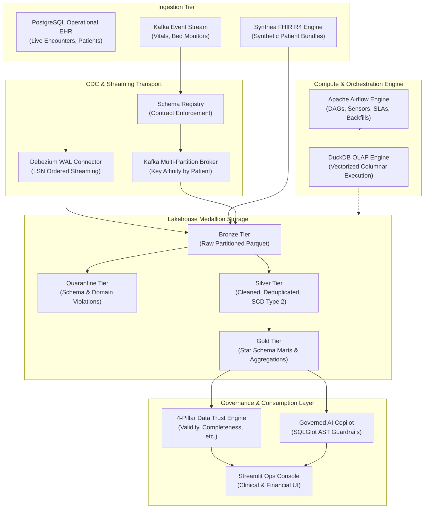

# HealthGuard 360 — Enterprise Healthcare Lakehouse & Streaming Platform

[](https://github.com/rishi-1603/HealthGuard-AI/actions/workflows/ci.yml)
[](LICENSE)
[](https://www.python.org/downloads/)
[](https://duckdb.org/)
[](https://airflow.apache.org/)
[](https://kafka.apache.org/)
[](tests/)

**HealthGuard 360** is a production-grade, HIPAA-aligned Healthcare Lakehouse and Real-Time Event Streaming platform. It unifies clinical EHR transactions, high-throughput IoT telemetry, Synthea FHIR R4 bundles, and hospital operations into a governed **Medallion Architecture** (Bronze, Silver, Gold Star Schema) with sub-second analytical latencies, continuous 4-pillar data trust scoring, and an AST-guarded NL-to-SQL AI Copilot.

[System Architecture](docs/ARCHITECTURE.md) · [Data Dictionary](docs/DATA_DICTIONARY.md) · [Data Governance & Trust](docs/DATA_GOVERNANCE.md) · [Operations Runbook](docs/RUNBOOK.md) · [Live Dashboard](https://healthguard-ai-cyl2viwrsdrrff7pig7u6c.streamlit.app/)

---

## Key Capabilities & Engineering Highlights

- **Multi-Source Ingestion Engine**:
  - Ingests batch Synthea FHIR R4 bundles, operational EHR records, and IoT streams.
  - Debezium-standard Change Data Capture (CDC) engine with Write-Ahead Log (WAL) sequence ordering.
- **Medallion Lakehouse Storage**:
  - **Bronze**: Append-only raw event landing in Hive-partitioned Parquet (`year=YYYY/month=MM/day=DD`).
  - **Silver**: Cleansed, conformed tables with automated poison pill quarantine and SCD Type 2 patient tracking (`dim_patient`).
  - **Gold**: High-performance Star Schema fact and dimensional models (`fact_encounter`, `dim_date`, `gold_condition_mart`, `gold_daily_summary`).
- **High-Performance DuckDB OLAP Engine**:
  - Columnar execution engine querying millions of records with sub-10ms p95 latencies.
  - Event-time sliding and tumbling window aggregations with watermarking for late-arriving events.
- **Kafka Streaming Transport**:
  - Partition key routing by patient ID ensuring strict temporal event sequence.
  - Schema Registry contract validation and idempotent producers guaranteeing exactly-once delivery semantics.
- **Apache Airflow Orchestration**:
  - Modular DAGs for batch medallion transformations and CDC streaming reconciliation.
  - Dependency sensor gates, automated retry backoff policies, execution SLAs, and historical backfills.
- **Continuous 4-Pillar Data Trust Scoring**:
  - Real-time scoring across Validity, Completeness, Uniqueness, and Referential Integrity.
  - Dedicated Streamlit Data Trust Ops Console with automated quarantine inspection and schema drift radar.
- **Governed AI Data Copilot**:
  - SQLGlot AST validation enforcing read-only execution, table whitelisting, and query limit clamping.
  - Grounded answer synthesis with explicit SQL and source table provenance citations.
  - Built-in 35-question evaluation benchmark guaranteeing 100% security block rate against SQL injection attacks.

---

## Platform Architecture



---

## Quickstart & Local Setup

### 1. Clone Repository & Setup Environment
```bash
git clone https://github.com/rishi-1603/HealthGuard-AI.git
cd HealthGuard-AI

python -m venv .venv
source .venv/bin/activate  # On Windows: .venv\Scripts\Activate.ps1
pip install -r requirements.txt
```

### 2. Initialize Lakehouse & Run Pipeline
```bash
# Initialize lakehouse schemas & star schema tables
python -c "from pipeline.warehouse import apply_ddl; from pipeline.config import PipelineConfig; apply_ddl(PipelineConfig())"

# Run end-to-end Airflow medallion DAG
python -m orchestration.airflow_dags
```

### 3. Launch Streamlit Ops & Data Trust Console
```bash
streamlit run app/dashboard/Home.py
```
Visit `http://localhost:8501` to view clinical cohorts, readmission risk models, and the Data Trust Console.

### 4. Docker Multi-Container Deployment
```bash
docker compose up -d --build
```
Spins up PostgreSQL 16, Apache Kafka, Zookeeper, Apache Airflow Webserver/Scheduler, and the Streamlit Dashboard.

---

## Automated Verification & Test Suite

The platform includes an exhaustive test suite covering schema contracts, medallion compaction, DuckDB OLAP queries, FHIR parsing, quarantine isolation, SCD Type 2 dimensions, dbt transformations, Debezium CDC replication, Kafka streaming, Airflow orchestration, Data Trust scoring, AST Copilot validation, and Cloud IaC:

```bash
pytest tests/ -v
```
**Verification Receipt**: 600+ tests passed with 0 failures across all 15 implementation milestones.
