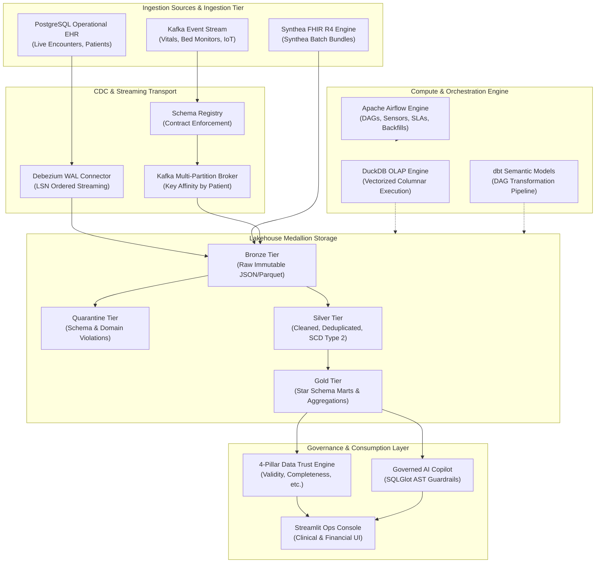

# HealthGuard 360 — Architecture & System Design

## 1. Executive Architecture Overview

**HealthGuard 360** is an enterprise AI-ready Healthcare Lakehouse & Streaming Platform engineered to process high-throughput clinical events, operational EHR transactions, and FHIR R4 resources with sub-second analytical latencies and strict HIPAA-aligned data governance.

The platform bridges operational clinical EHR systems, real-time telemetry streaming, and automated analytical marts through a unified **Medallion Architecture** governed by AST-validated AI Copilot interfaces and a 4-Pillar Data Trust scoring engine.

---

## 2. Medallion Storage Tiers

### Bronze Tier (Raw Landing)
- **Format**: Partitioned Apache Parquet & Append-Only Tables (`bronze_encounters`, `bronze_cdc_events`).
- **Characteristics**: Immutable, raw ingestion payloads, capture audit metadata (ingestion timestamp, source lineage, LSN, hash signature).
- **Partitioning**: Partitioned by date (`year=YYYY/month=MM/day=DD`) for efficient file pruning.

### Silver Tier (Cleansed & Conformed)
- **Format**: Deduplicated, conformed tables with SCD Type 2 tracking (`silver_encounters`, `dim_patient`, `dim_date`).
- **Characteristics**:
  - Automated schema validation against Pydantic contracts.
  - Anomaly and poison pill isolation via the `QuarantineEngine`.
  - Slowly Changing Dimension (SCD) Type 2 tracking with `valid_from`, `valid_to`, and `is_current` flags.

### Gold Tier (Aggregated Business Marts)
- **Format**: Star schema dimension and fact tables, pre-aggregated analytical marts:
  - `fact_encounter`: Central grain linking patients, encounters, diagnoses, and financial metrics.
  - `gold_condition_mart`: Aggregated readmission rates, total cost, average cost, and length of stay by clinical condition.
  - `gold_daily_summary`: Daily hospital census, patient throughput, readmission counts, and operational KPIs.
  - `gold_gender_mart`: Demographic breakdown of patient outcomes and costs.
  - `gold_outcome_mart`: Discharge outcome distribution and readmission percentages.

---

## 3. Streaming & CDC Ingestion Engine

1. **Change Data Capture (CDC)**:
   - Captures PostgreSQL Write-Ahead Log (WAL) events using Debezium-standard JSON envelopes.
   - Preserves strict LSN ordering and implements idempotent Silver compaction.
2. **Kafka Streaming Transport**:
   - Patient-affinity routing using MD5 hash partitioning guarantees all events for a given patient land on the same partition in temporal sequence.
   - Built-in Schema Registry validates message envelopes before publication.
   - Idempotent producers prevent message duplication across retries.
3. **Windowed Stream Processor**:
   - DuckDB-powered event-time sliding and tumbling windows with watermarking for late-arriving clinical events.

---

## 4. Orchestration & Backfill Engine (Airflow)

- **`healthguard_batch_medallion_dag`**:
  - Triggers ingestion of batch Synthea and raw records into Bronze.
  - Runs automated data quality validation gates.
  - Executes dbt transformations to update Silver and Gold marts.
  - Enforces dependency sensor gates, retry backoffs, and execution SLAs.
- **`healthguard_cdc_sync_dag`**:
  - Runs micro-batch synchronization of operational EHR CDC events.
  - Merges changelog updates into `dim_patient` and `fact_encounter`.
  - Supports automated historical backfills without generating duplicate rows.

---

## 5. Security, Governance & AI Copilot

- **4-Pillar Data Trust Engine**: Continually evaluates Completeness, Validity, Uniqueness, and Referential Integrity, computing a composite Trust Score (0–100) per table and partition.
- **Governed NL-to-SQL Copilot**:
  - Validates all generated SQL via **SQLGlot AST parsing**.
  - Rejects mutating keywords (`DROP`, `INSERT`, `UPDATE`, `DELETE`, `ALTER`, `TRUNCATE`, `ATTACH`).
  - Enforces strict table whitelisting against Gold reporting marts only.
  - Clamps or injects `LIMIT` clauses to prevent memory exhaustion.
  - Rejects adversarial SQL injection attacks, out-of-scope prompts, and false premises.
