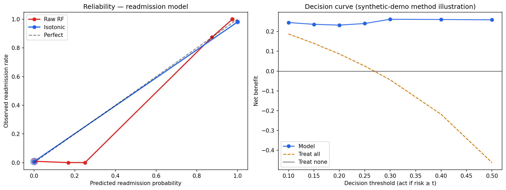

# Calibration & Decision-Curve Analysis — Readmission Model
### Are the probabilities honest, and would acting on them help?

> Generated by `scripts/calibration_decision_curve.py` · protocol: **fit 64% / calibration 16% / test 20%, stratified, random_state=42**
> n = 984 patients (fit 629 / cal 158 / test 197) · test prevalence 26.9%
>
> ⚠️ Synthetic-data **method demonstration** — no clinical validity, no patient benefit claimed. See `reports/model_honesty.md` for why the AUC is not skill.

---

## 1. Calibration

| Variant | Brier ↓ | ECE ↓ | Intercept (=0 ideal) | Slope (=1 ideal) |
|---|---|---|---|---|
| raw | 0.0187 | 0.0463 | -0.9778 | 1.4341 |
| isotonic | 0.0102 | 0.0101 | -0.626 | 0.3261 |

Prevalence-reference Brier (always predict the base rate): **0.269** — the model must beat this.

**Finding:** the raw RandomForest is under-confident (slope 1.4341): its probabilities do not spread as far as the outcome separation warrants — a symptom of `class_weight='balanced'` shrinking the effective probability scale. Isotonic scaling improves Brier score and ECE without changing the ranking.

### Reliability table (raw)

| Bin | n | Mean predicted | Observed rate |
|---|---|---|---|
| [0.0,0.1] | 112 | 0.0034 | 0.0089 |
| [0.1,0.2] | 8 | 0.1683 | 0.0 |
| [0.2,0.3] | 24 | 0.2505 | 0.0 |
| [0.3,0.4] | 0 | — | — |
| [0.4,0.5] | 0 | — | — |
| [0.5,0.6] | 0 | — | — |
| [0.6,0.7] | 0 | — | — |
| [0.7,0.8] | 0 | — | — |
| [0.8,0.9] | 8 | 0.8746 | 0.875 |
| [0.9,1.0] | 45 | 0.9746 | 1.0 |

## 2. Decision-curve analysis (net benefit)

Net benefit = TP/n − FP/n · t/(1−t). Higher is better; a useful model must beat both 'treat all' and 'treat none' at the thresholds a team would actually use.

| Threshold | Model | Treat all | Treat none | Model wins? |
|---|---|---|---|---|
| 0.1 | 0.2453 | 0.1878 | 0.0 | ✅ |
| 0.15 | 0.2362 | 0.1400 | 0.0 | ✅ |
| 0.2 | 0.2322 | 0.0863 | 0.0 | ✅ |
| 0.25 | 0.2403 | 0.0254 | 0.0 | ✅ |
| 0.3 | 0.2618 | -0.0442 | 0.0 | ✅ |
| 0.4 | 0.2606 | -0.2183 | 0.0 | ✅ |
| 0.5 | 0.2589 | -0.4619 | 0.0 | ✅ |

**Score:** the model beats treat-all at **7/7** tested thresholds.

## 3. Subgroup confidence intervals (bootstrap, 1000 draws)

### By Age band

| Group | n | n_pos | AUC [95% CI] | Precision [95% CI] | Recall [95% CI] |
|---|---|---|---|---|---|
| 18-30 | 20 | 0 | — | — | — | *too few patients or too few positives (<5) - no metric reported (a perfect AUC on 2 positives is noise)* |
| 31-45 | 36 | 2 | — | — | — | *too few patients or too few positives (<5) - no metric reported (a perfect AUC on 2 positives is noise)* |
| 46-60 | 63 | 27 | 0.9856 [0.9457, 1.0] | 0.963 [0.875, 1.0] | 0.963 [0.8786, 1.0] |
| 61-75 | 59 | 15 | 1.0 [1.0, 1.0] | 1.0 [1.0, 1.0] | 1.0 [1.0, 1.0] |
| 76-+ | 19 | 9 | 1.0 [1.0, 1.0] | 1.0 [1.0, 1.0] | 1.0 [1.0, 1.0] |

### By Gender

| Group | n | n_pos | AUC [95% CI] | Precision [95% CI] | Recall [95% CI] |
|---|---|---|---|---|---|
| Female | 103 | 47 | 0.9992 [0.9962, 1.0] | 0.9792 [0.9286, 1.0] | 1.0 [1.0, 1.0] |
| Male | 94 | 6 | 0.9811 [0.9235, 1.0] | 1.0 [1.0, 1.0] | 0.8333 [0.4286, 1.0] |

**Why CIs matter:** a subgroup AUC of 1.0 on 20 patients means nothing. Wide intervals are the honest answer when a band is thin — and single-class bands get no metric at all rather than a fabricated one.

## 4. Verdict

> **Methodically: the model's ranking adds decision value over treat-all/treat-none at most thresholds, and isotonic calibration makes its probabilities usable. Clinically: nothing here transfers — the label is synthetic-deterministic and the honesty audit's warning stands.**

## 5. Limitations

1. Synthetic labels are near-deterministic given Condition — calibration on synthetic-deterministic data is a method demo only.
2. Decision thresholds 0.10–0.50 are illustrative; a clinical threshold would require cost/benefit elicitation from clinicians.
3. Subgroup CIs use 1000 bootstrap draws on a 197-patient test slice — intervals are wide by construction and should be.
4. Net-benefit comparisons use raw (shipped) probabilities; the isotonic variant would shift operating points modestly.

---

*Numbers pinned by `tests/test_calibration_decision_curve.py`.*